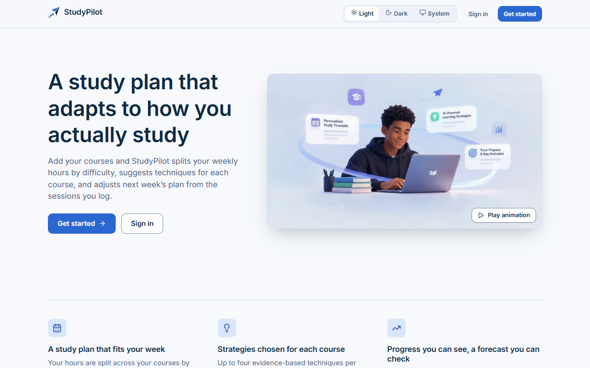
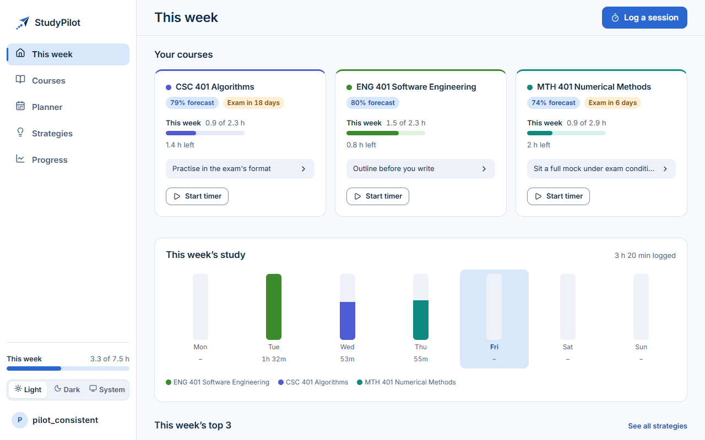
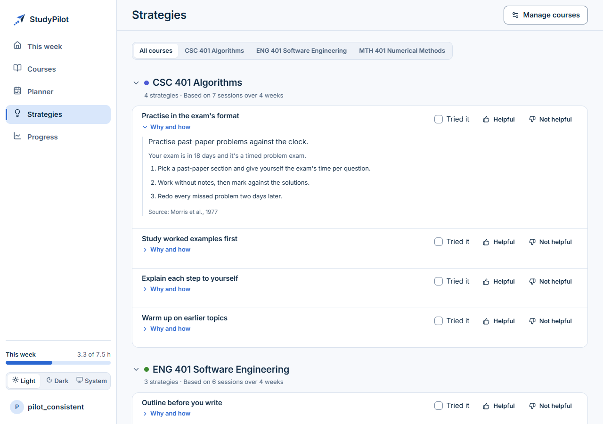
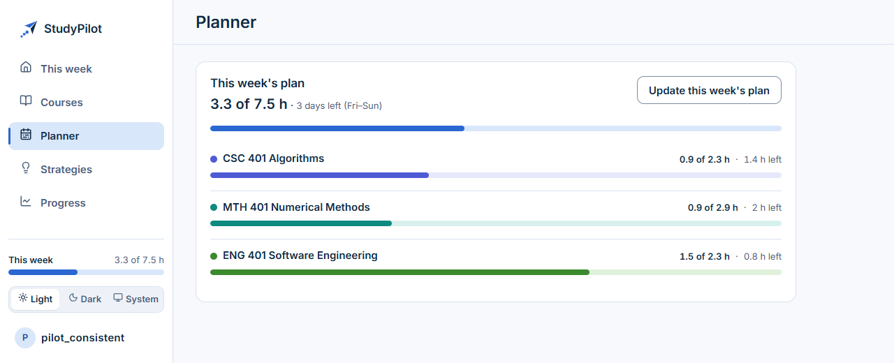
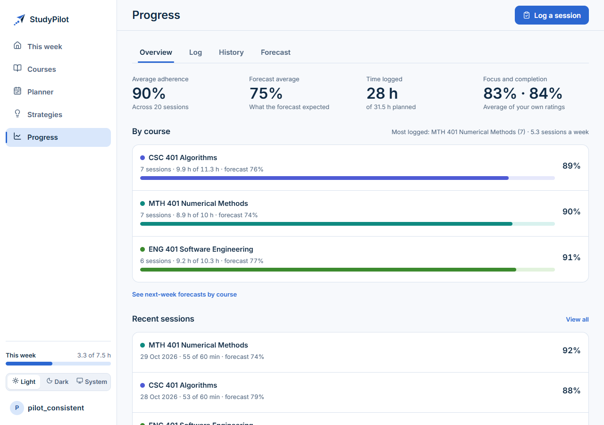
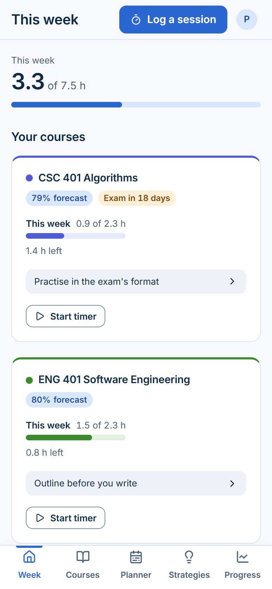

# StudyPilot

**A study plan that adapts to how you actually study.** Add your courses and StudyPilot splits your
weekly hours by difficulty, suggests evidence-based techniques for each course, and adjusts the plan
from the sessions you log.

**Live site: <https://studypilot-sp.vercel.app>**. Sign up with your own email; a 6-digit code
confirms the address. The backend runs on a free plan that sleeps when idle, so the first request
after a quiet spell can take about a minute while it wakes up.



## Screenshots

| | |
|---|---|
|  |  |
| **This week**: hours left per course, the forecast, the top strategy and a timer | **Strategies**: chosen from your data, each with its reason and source |
|  |  |
| **Planner**: one plan per week, updated mid-week | **Progress**: adherence, forecast and recent sessions |

On a phone the sidebar becomes a tab bar:



## Features

- **My courses, with learning traits.** For each course: difficulty (1 to 5), how it is assessed
  (timed problem exam, multiple choice, essay exam, coursework or continuous quizzes), what it
  demands (problem solving, conceptual understanding, memorisation, writing, practical work), whether
  it builds on earlier courses, and an exam date. All of it is optional, and the recommendations use
  whatever you give them.
- **One weekly plan, updated mid-week.** Your weekly hours are split across courses by difficulty,
  nudged up or down by each course's forecast. "Update this week's plan" shares the hours that are
  left with a catch-up split: courses you have already logged a lot on get less, so the week still
  adds up. Earlier revisions of a week's plan are kept as history.
- **Study timer and logging.** Start a timer on a course; when you stop it, you confirm your own focus
  and completion ratings and the session is logged. The elapsed time is worked out from the start
  time, so a refresh or a sleeping laptop does not make it drift. A session can also be logged by hand, and the
  history can be browsed.
- **A This week home page.** Course cards with the forecast, the exam countdown, the hours left and a
  timer button, a bar for each day of the week, and the top strategies.
- **Strategies chosen from your data.** Up to four per course, picked from a library of 16 study
  techniques and habits using how the course is assessed, how close the exam is and how your sessions
  are going. Each shows why it was chosen, the steps, and one cited source. You can mark each as
  *Tried it*, *Helpful* or *Not helpful*. Helpful ones are favoured; a *Not helpful* strategy rests for
  4 weeks and the next fitting one takes its place, and **Show again** brings a resting one back.
- **An optional AI-written weekly plan.** When an Anthropic API key is set, the strategies already
  chosen can be written up as a short plan for the week. The model can only describe the strategies it
  is given: it never adds, drops or reorders them, and any answer that fails the checks is replaced by
  the rules-based plan (see [How it works](#how-it-works)). Without a key, everything else works the
  same.
- **A next-week adherence forecast.** For each course, a model estimates how much of next week's plan
  you are likely to complete. The planner uses it to adjust the hours, and Progress shows it.
- **Email verification and password reset**, both with a 6-digit code that expires after 15 minutes.
- **An account page** to change your username, email (with a code sent to the new address) or password,
  and to delete your account.
- **Light and dark themes, and a mobile layout.** The theme follows your system unless you choose one.
  The component tests include automated accessibility checks (axe), and the colour tokens are checked
  against the WCAG AA contrast ratios.

## How it works

### Architecture

```
Browser
  │  Next.js 16 + React 19 (TypeScript), hosted on Vercel
  │  JSON over HTTPS, JWT access and refresh tokens
  ▼
Django 5 + Django REST Framework + SimpleJWT, hosted on Render (gunicorn)
  ├── PostgreSQL on Neon                  all app data, and the shared cache for rate limits
  ├── scikit-learn model, loaded in-process (joblib file in this repo)
  ├── Brevo (SMTP)                        verification and password-reset codes
  ├── Sentry                              error tracking, errors only
  └── Anthropic API (optional)            the AI-written weekly plan
```

Locally the database is SQLite by default (or the Postgres container in `docker-compose.yml`).

### The recommendation engine

For each course the engine runs in steps, and everything except the data gathering is plain, testable
code:

1. **Gather** the course's traits, its session logs and its forecast.
2. **Diagnose**: checks such as an exam inside 7 or 21 days, low adherence, a declining trend, sparse
   spacing between sessions, long sessions that finish poorly, and low focus.
3. **Select** at most four strategies: at most one for the exam, at most two about habits or schedule,
   and techniques for the rest. Your ratings apply here (helpful first, not helpful resting). Ties
   fall back to library order, so the same data gives the same answer.
4. **Explain**: each strategy comes with its steps, the numbers from your data that triggered it, and
   its source.

The optional AI step then rewrites those strategies as a weekly plan, and the answer is validated
before anyone sees it: one item per strategy, in order, with the exact strategy ids; every number the
strategy relies on must appear as given; no other numbers may appear; and length limits apply. If
anything fails, if the key is not set, or if the per-user daily limit is reached (20 model calls a day
by default), the rules-based text is shown instead. Answers that pass are cached by their input, and
rejected answers are not.

### The adherence forecast

A Random Forest regressor (scikit-learn) forecasts a course's adherence for the coming week from the
weeks before it, using five features built only from earlier weeks. It was trained on a weekly panel
built from the Open University Learning Analytics Dataset (OULAD), splitting by presentation so no
student-week appears in both training and test data. Where a course has fewer than two complete weeks
of logs, the planner falls back to the observed average of the last 30 days.

Results on the held-out test presentation (OULAD 2014J, 239,456 rows):

| | MAE | RMSE | R² |
|---|---:|---:|---:|
| Forecast model | 0.307 | 0.380 | 0.314 |
| 3-week mean baseline | 0.268 | 0.403 | 0.229 |
| Last-week baseline | 0.277 | 0.462 | −0.014 |

These are modest numbers, and the limitations matter:

- The model has **lower RMSE and higher R² than every baseline, but a higher MAE** than the 3-week
  mean and last-week baselines. It was judged on RMSE and R², and MAE is reported as it is.
- An R² of 0.314 means most of the variation in next week's adherence is **not** explained.
- About 96% of the model's feature importance sits on the 3-week mean, so the forecast stays close to
  it, pulled toward the population average.
- It was trained on how much a learner clicks relative to their cohort. In the app, adherence is the
  minutes you log against your own plan. The model has never seen app data, so the two measures are
  assumed to behave alike.
- The test set is one presentation of a UK distance-learning population.

The full evaluation, including the leakage problem found in an earlier version of the model and how it
was fixed, is in [docs/evaluation-report.md](docs/evaluation-report.md). The training pipeline is in
[backend/ml/README.md](backend/ml/README.md).

## Run it locally

You need Python 3.12, Node.js 24 and Git. Docker is only needed if you want PostgreSQL instead of
SQLite. The commands below are for Windows PowerShell, with the macOS and Linux differences noted.

### Backend

From the repository root:

```powershell
python -m venv .venv
.venv\Scripts\Activate.ps1
pip install -r backend\requirements.txt
Copy-Item backend\.env.example backend\.env
cd backend
python manage.py migrate
python manage.py seed_pilot_data
python manage.py runserver 8000
```

On macOS and Linux, use `source .venv/bin/activate` and `cp backend/.env.example backend/.env`. If
PowerShell refuses to run the activation script, run
`Set-ExecutionPolicy -Scope Process -ExecutionPolicy Bypass` first.

`backend/.env.example` uses SQLite and turns debug mode on, which is right for local work. With debug
on, the verification and reset emails are printed in the server's console instead of being sent, so
you can sign up without a mail server.

`seed_pilot_data` creates five demo accounts with a plan and about four weeks of sessions each.
**For local development only:** their password is `Pilot12345!`, and `pilot_consistent` has the
richest data. With debug off the command refuses to run unless you pass `--allow-production` and set a
strong `PILOT_PASSWORD`.

To try the AI-written plans locally, add `ANTHROPIC_API_KEY=...` to `backend/.env`. Never commit a key.

### Frontend

In a second terminal, from the repository root:

```powershell
cd frontend
npm ci
Copy-Item .env.example .env.local
npm run dev
```

(On macOS and Linux, `cp .env.example .env.local`.) Open <http://localhost:3000>. `.env.local` points
the site at the API on `http://127.0.0.1:8000/api`.

### PostgreSQL with Docker (optional)

```powershell
docker compose up -d db
```

Then set `DB_ENGINE=postgres` in `backend/.env` and run `python manage.py migrate` again. The
container listens on port `55432` on your machine; if that port is taken, change it in
`docker-compose.yml` and set `DB_PORT` to match. The container is named `studypilot_postgres`. The
database name, user and volume keep their earlier names (`fyp_db`, `fyp_user`, `pgdata`), so data in an
existing local volume still works. If you still have an older container named `fyp_postgres`, stop and
remove it first, because it holds the same port.

### Tests

```powershell
# backend, from backend\
python manage.py test

# frontend, from frontend\
npm test
npx tsc --noEmit
npm run lint
npm run build
```

`npm run build` needs `NEXT_PUBLIC_API_BASE_URL`, which `.env.local` provides.

## Deploying

The live site runs on free plans: Neon for the database, Render for the API and Vercel for the
frontend. [docs/deploy.md](docs/deploy.md) is the step-by-step runbook, including email, error
tracking and checking the rate limits behind Render's proxy.

## Project structure

```
backend/             Django project
  apps/              users, planner, recommendations, tracking, common
  config/            settings and URL configuration
  ml/                forecast pipeline, schema notes and the trained model
frontend/            Next.js app
  app/               pages (App Router): auth, onboarding and the workspace
  components/        shared UI, app shell, timer, landing page
  lib/               API client, session, timer and plan helpers
docs/                deploy runbook, evaluation report, images
docker-compose.yml   optional local PostgreSQL
render.yaml          Render service definition
```

## Privacy

- **Error tracking sends errors only.** Sentry never receives request bodies (so no passwords or email
  codes), cookies, `Authorization` headers, usernames, email addresses, user IDs, IP addresses, query
  strings or fragments in page addresses, local variables, performance traces or session replays. It
  is off unless a Sentry address is configured.
- **The AI plan sends course data, not personal data.** The model receives a course's name, difficulty
  and traits, a summary of the evidence (such as session counts and adherence figures) and the chosen
  strategies' text. It does not receive your username, email or account ID.
- You can delete your account and its data from the Account page.

## Dataset (OULAD)

The forecast is trained on the **Open University Learning Analytics Dataset (OULAD)**, licensed under
Creative Commons Attribution 4.0 International. It is not in this repository. To rebuild the panel or
retrain the model, download the seven CSV files from <https://analyse.kmi.open.ac.uk/open-dataset> into
`Dataset/` at the repository root, then follow [backend/ml/README.md](backend/ml/README.md). The raw
data, the generated panel and the reports are git-ignored; only the trained model and its metadata file
are committed, so running the app needs no dataset.
